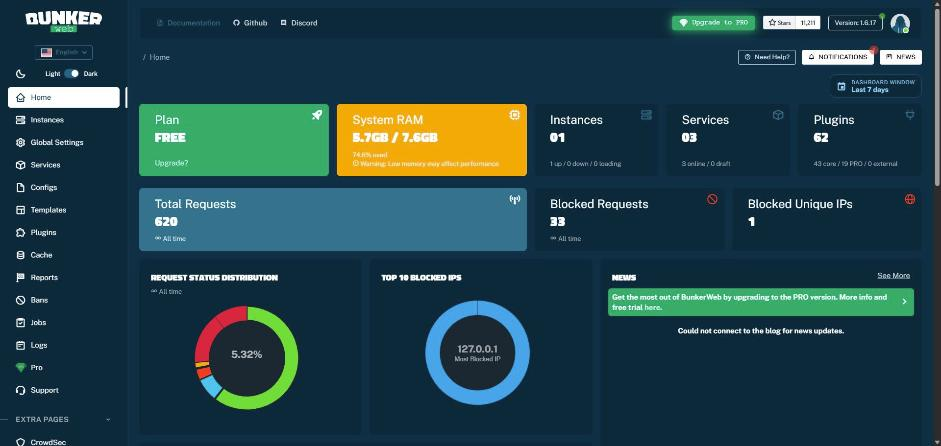
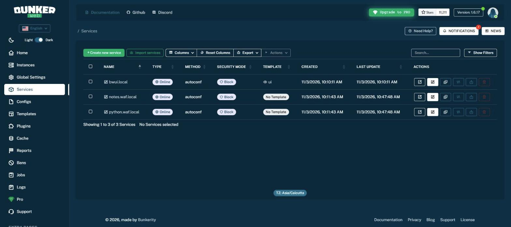
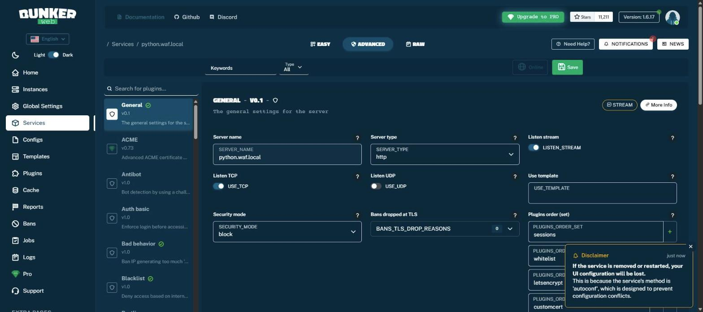
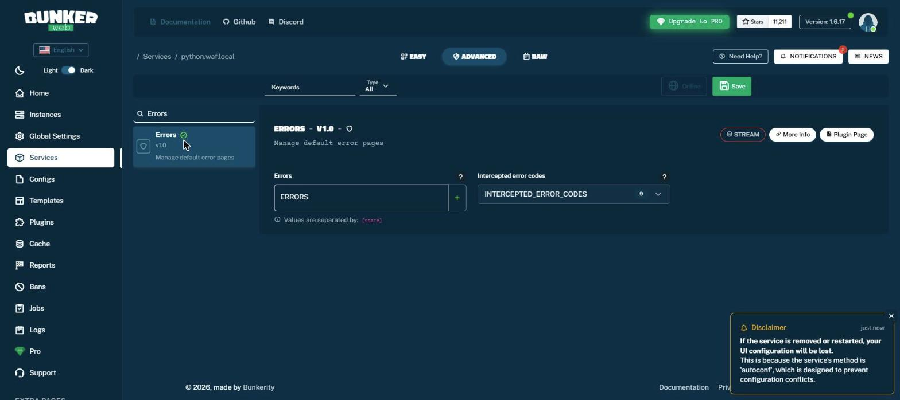
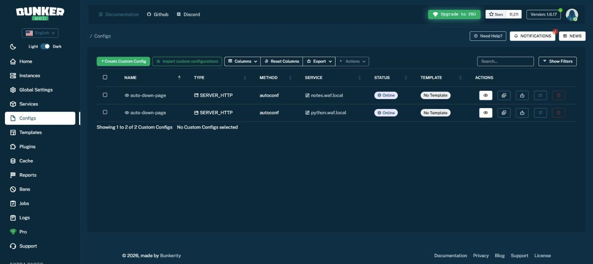
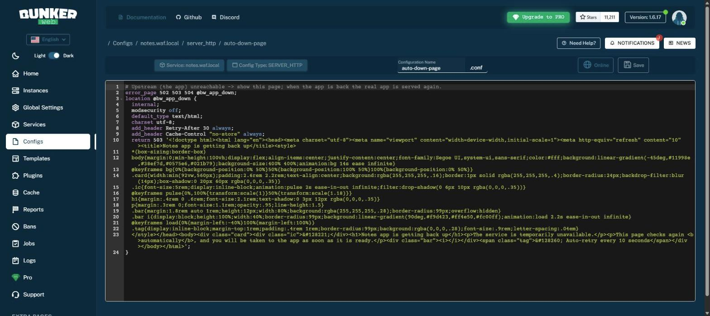
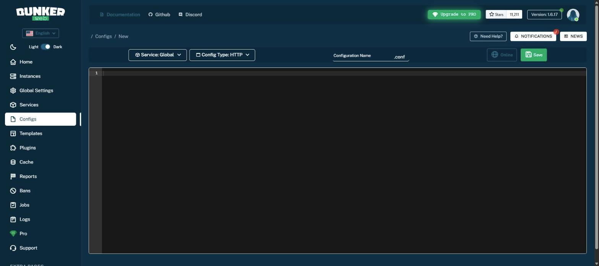
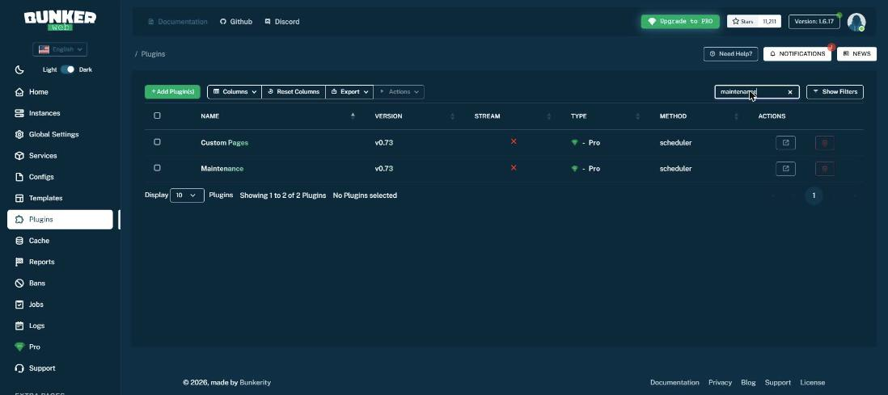
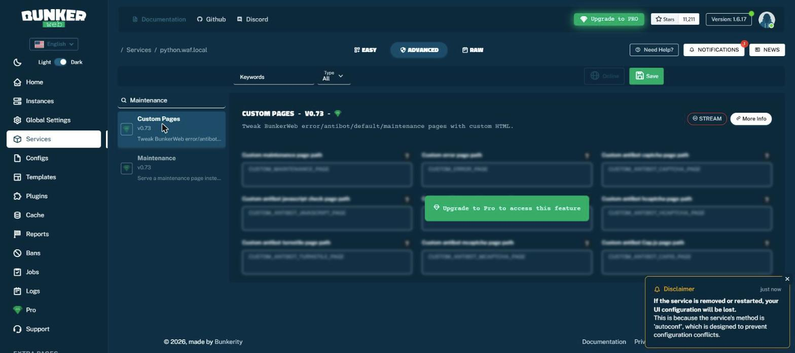

# BunkerWeb WAF on Kubernetes: step-by-step tutorial

From installing BunkerWeb, through adding the **notes app** and the **python app**, to blocking attacks, remote access,
the automatic "service is down" page and planned-maintenance mode, with the GUI screens.
Everything here was done and tested on the kind cluster `mycluster` (3 nodes, Docker Desktop).
Files for every step are in the repo: https://github.com/ajaysunkaranam89-ai/WAF

> **What is verified and what is not.** Commands, results and GUI screens in this tutorial were run or seen on this cluster
> (BunkerWeb 1.6.17, Helm chart 1.3.0). The first-run wizard (where you create the admin login) is described but has no
> screenshot, because it was completed before the screenshots were taken. The Reports, Bans, Jobs and Logs pages were not opened
> while writing this, so they are only mentioned.

---

## 0. The big picture

```
 Browser / curl
      |   Host: python.waf.local   (or notes.waf.local)
      v
 [ kubectl port-forward :8080 ]  -->  BunkerWeb (nginx + ModSecurity + OWASP rules)  -->  python-app-service  -->  python pods
                                              |   decides by hostname (Ingress)         \->  notes-app            -->  notes pods
                                              +-- blocks attacks (403)
                                              +-- shows "service is down" page if the app is unreachable
                                              +-- shows "maintenance" page when you switch it on
```

| Piece | Where it runs | What it is |
|---|---|---|
| BunkerWeb engine (`mybw-bunkerweb`) | namespace `bunkerweb` | the WAF/reverse proxy |
| `scheduler`, `controller`, `ui`, `mariadb`, `redis` | namespace `bunkerweb` | config, Ingress watcher, web GUI, database, cache |
| notes app | namespace `notes`, Service `notes-app:80` | Node.js + PostgreSQL app |
| python app | namespace `python-app`, Service `python-app-service:80`, Deployment `python-app` (3 replicas) | Flask app (managed by Argo CD) |

Why BunkerWeb: it is open source, has a web GUI, and is configured for Kubernetes by plain **Ingress** resources.
(SafeLine was tried first and abandoned: its internal detector rejected its own components with `401 without valid token`,
so no site could be added. ModSecurity + OWASP rules, in `k8s/waf.yaml`, also works but has no GUI; it is scaled to 0.)

---

## 1. Install BunkerWeb with Helm

Prerequisites: `kubectl`, `helm` 3.8+, a working cluster, 1.5 GB free memory.

```bash
helm repo add bunkerweb https://repo.bunkerweb.io/charts
helm repo update
helm install mybw bunkerweb/bunkerweb -n bunkerweb --create-namespace -f bunkerweb/values.yaml
kubectl get pods -n bunkerweb          # wait until all 6 pods are 1/1 Running
```

`bunkerweb/values.yaml` (the choices that matter):

| Setting | Value | Why |
|---|---|---|
| `service.type` | `ClusterIP` | kind has no load balancer; we use port-forward |
| `scheduler.features.global.securityMode` | `block` | really block attacks (`detect` = only log) |
| `...modsecurity.useModsecurity` / `useModsecurityCrs` | `yes` / `yes`, CRS version `4` | ModSecurity + OWASP Core Rule Set |
| `settings.ui.wizard` | `true` | first-run wizard creates the admin account |
| `settings.ui.ingress` | host `bwui.local`, class `bunkerweb` | exposes the GUI as a service too |
| resource limits | small (WAF 1 Gi, scheduler 512 Mi) | the Docker Desktop VM has only 7.6 GiB |

The 6 pods: `mybw-bunkerweb` (the WAF), `scheduler` (renders the nginx config), `controller` (watches Kubernetes Ingresses),
`ui` (the GUI), `mariadb` (settings database), `redis` (shared state).

---

## 2. Open the GUI and create the admin account

```bash
kubectl port-forward -n bunkerweb svc/ui-mybw-bunkerweb 7000:7000
```
Open **http://localhost:7000**. On the very first visit it redirects to the setup wizard (`/setup`) where **you** choose the admin
username and password. Keep them private and never put them in git. After that, log in at the same address.

After login you land on the **Home** dashboard:



What you see: plan (FREE), system RAM, number of instances (1), **Services (3 online)**, plugins (62: 43 core and 19 PRO),
total and blocked requests, request status distribution, and the top blocked IPs. The 403/429/502/503 numbers in the chart come
from the attack and outage tests in this tutorial.

---

## 3. Add the two applications (Ingress)

BunkerWeb on Kubernetes is configured by Ingresses with `ingressClassName: bunkerweb`. The Ingress must be in the **same
namespace** as the app's Service. File: `bunkerweb/ingresses.yaml`.

```yaml
apiVersion: networking.k8s.io/v1
kind: Ingress
metadata:
  name: python-app-waf
  namespace: python-app
  annotations:
    bunkerweb.io/USE_MODSECURITY: "yes"
    bunkerweb.io/USE_MODSECURITY_CRS: "yes"
    bunkerweb.io/INTERCEPTED_ERROR_CODES: "400 401 403 404 405 413 429 500 501"   # see section 6
    bunkerweb.io/REVERSE_PROXY_CONNECT_TIMEOUT: "5s"                               # see section 6
spec:
  ingressClassName: bunkerweb
  rules:
    - host: python.waf.local            # the name users type
      http:
        paths:
          - path: /
            pathType: Prefix
            backend:
              service:
                name: python-app-service   # the app's Kubernetes Service
                port:
                  number: 80
```
The notes app is the same with `namespace: notes`, `host: notes.waf.local`, service `notes-app`.

```bash
kubectl apply -f bunkerweb/ingresses.yaml
kubectl get ingress -A | grep waf.local
```
Within about 30 to 60 seconds the controller notices the Ingresses, the scheduler renders nginx config and reloads the WAF.

### How it looks in the GUI: **Services**



- `notes.waf.local` and `python.waf.local` are listed as **Online**, **Method = autoconf** (they come from Kubernetes Ingresses)
  and **Security mode = Block**. `bwui.local` is the GUI itself.
- The buttons in the row open the site, edit it, clone it, move it, export it and delete it.
- The green **Create new service** button exists too, but for Ingress-managed apps we add sites by Ingress (that way they live in git).

### Service settings screen

Click the edit (pencil) icon on a service:



- Three modes at the top: **Easy**, **Advanced** (all plugins and settings, shown here) and **Raw** (plain key=value).
- Left list = plugins (General, ACME, Antibot, Bad behavior, Blacklist ... ). The right side shows the settings of the selected plugin.
  `General` shows `SERVER_NAME = python.waf.local` and `SECURITY_MODE = block`.
- **Important disclaimer (seen in the GUI):** for services whose method is `autoconf`, changes made in the GUI are **lost when the
  service is removed or restarted**, because Kubernetes is the source of truth. Make permanent changes in the Ingress annotations
  or ConfigMaps in git, not in the GUI.

---

## 4. Reach the apps and prove the WAF blocks attacks

BunkerWeb picks the site by **hostname**, so the browser must use `python.waf.local` / `notes.waf.local`.

1. Map the names to your PC. In **PowerShell as Administrator**:
   ```powershell
   Add-Content -Path "$env:SystemRoot\System32\drivers\etc\hosts" -Value "127.0.0.1  notes.waf.local  python.waf.local"
   ```
2. Forward the WAF port and keep it running:
   ```bash
   kubectl port-forward -n bunkerweb svc/mybw-bunkerweb-external 8080:80
   ```
3. Open **http://python.waf.local:8080** and **http://notes.waf.local:8080**.

Without a hosts entry, test with curl: `curl -H "Host: python.waf.local" http://127.0.0.1:8080/`.

> Use `127.0.0.1`, not `localhost`, in curl on Windows. `localhost` tries IPv6 first, where Docker Desktop answers on port 8080,
> so you would not reach BunkerWeb at all.

### Attack tests (13 requests per app, same result on both)

| Request | Result |
|---|---|
| normal page and `/health` | 200 |
| SQL injection (`id=1' OR '1'='1`, `UNION SELECT`) | **403 blocked** |
| XSS (`<script>alert(1)</script>`, ``) | **403 blocked** |
| path traversal (`/../../etc/passwd`) | **400 rejected** |
| file inclusion, command injection (`;cat /etc/passwd`) | **403 blocked** |
| Log4Shell header (`${jndi:ldap://...}`) | **403 blocked** |
| scanner user-agent (`sqlmap`) | **403 blocked** |
| POST body with SQLi and XSS | **403 blocked** |
| normal page after all attacks | 200 |

Note: after several blocked requests from one address, BunkerWeb's **Bad behavior** feature briefly bans it (HTTP **429**),
then lets it back in. That is normal protection, not a fault.

---

## 5. Access from other computers

On the PC that runs the cluster:

1. Forward on all network interfaces:
   ```bash
   kubectl port-forward --address 0.0.0.0 -n bunkerweb svc/mybw-bunkerweb-external 8080:80
   ```
2. Allow the port in Windows Firewall (needs **Run as administrator**, otherwise "Access is denied"):
   ```powershell
   New-NetFirewallRule -DisplayName "BunkerWeb 8080" -Direction Inbound -Protocol TCP -LocalPort 8080 -Action Allow -Profile Domain,Private
   ```
3. On each client PC add to its hosts file: `<server-PC-IP>  notes.waf.local  python.waf.local` and open
   `http://python.waf.local:8080`.

Do the same for the GUI (port 7000) **only if you must**; it is an admin console. Restrict the firewall rule with
`-RemoteAddress <your-admin-PC-IP>`. If the other PC cannot connect, check the network profile (`Get-NetConnectionProfile`;
a Public network ignores Domain/Private rules) and test with `Test-NetConnection <ip> -Port 8080`.

---

## 6. Automatic "service is down" page (notes and python)

**Goal:** if an app stops (no healthy pods, crash, rollout), users see a friendly page instead of a raw error, and when the app is
back they get it again **without anyone switching anything**.

**What BunkerWeb does by default:** its built-in **Errors** plugin already catches 502/503/504 and shows its own generic page.
To show our own colourful page we replaced that handling.

### Step 6.1 Stop BunkerWeb's own pages for 502/503/504
Two annotations on the Ingresses (already in section 3):
- `INTERCEPTED_ERROR_CODES: "400 401 403 404 405 413 429 500 501"` (everything except 502/503/504)
- `REVERSE_PROXY_CONNECT_TIMEOUT: "5s"` (a dead app fails fast instead of hanging 60 s)

In the GUI this is the **Errors** plugin of the service (`ERRORS` and `INTERCEPTED_ERROR_CODES`, 9 codes now):



### Step 6.2 Add our page as a custom nginx config
File `bunkerweb/auto-error-page.yaml`: one ConfigMap per site, annotated so BunkerWeb loads it as a **server-http** config for that host.

```yaml
apiVersion: v1
kind: ConfigMap
metadata:
  name: autodown-python
  namespace: python-app
  annotations:
    bunkerweb.io/CONFIG_TYPE: "server-http"
    bunkerweb.io/CONFIG_SITE: "python.waf.local"
data:
  auto-down-page.conf: |
    error_page 502 503 504 @bw_app_down;
    location @bw_app_down {
      internal;
      modsecurity off;
      default_type text/html;
      charset utf-8;
      add_header Retry-After 30 always;
      add_header Cache-Control "no-store" always;
      return 503 '<!doctype html> ... colourful page with <meta http-equiv="refresh" content="10"> ...';
    }
```
The `refresh` tag reloads the page every 10 seconds, so users land back on the app as soon as it returns.
```bash
kubectl apply -f bunkerweb/auto-error-page.yaml -f bunkerweb/ingresses.yaml
```

### How it looks in the GUI: **Configs**



Both `auto-down-page` configs appear as **SERVER_HTTP**, method **autoconf**, one per service. Click the eye icon to read one:



The editor shows exactly the nginx text from the ConfigMap (this one is the notes app's page).

### Doing it by hand in the GUI instead
**Configs, then Create Custom Config** opens an empty editor:



Choose **Service** (for example `python.waf.local`), set **Config Type** to `SERVER_HTTP` (the default is `HTTP`), type a **Configuration
Name** (`auto-down-page`), paste the nginx text, and press **Save**. Remember the autoconf warning: GUI-only changes for
Ingress-managed sites can disappear; keep the master copy in git.

### Step 6.3 Test (done on a throw-away app, so the real apps stay up)
| Situation | Result |
|---|---|
| app has no pods | colourful page, HTTP 502, `Retry-After: 30`; an attack still gets **403** |
| a pod starts behind the service | real app served again about **15 seconds** later, no WAF change |

---

## 7. Maintenance mode for planned updates (the app keeps running)

**Goal:** the application is healthy, but during an update every user must see a maintenance page.

BunkerWeb has a plugin called **Maintenance** ("Serve a maintenance page instead of forwarding requests to the application")
and **Custom Pages**, but in this edition they are **Pro** features:





The GUI shows "Upgrade to Pro to access this feature". (An earlier answer that BunkerWeb has no maintenance feature was wrong:
it exists, but only in Pro.) The free-edition solution is the same custom-config mechanism, switched on and off with one command.

Files: `bunkerweb/maintenance-python.yaml`, `bunkerweb/maintenance-notes.yaml`, `bunkerweb/maintenance.ps1`.
Each ConfigMap makes nginx answer **every** request for that host with `return 503` and a colourful "We will be back soon" page.

```powershell
cd D:\AD\WAF\bunkerweb
.\maintenance.ps1 python on       # ON for python (takes effect in 30 to 45 s)
.\maintenance.ps1 python off      # back to normal
.\maintenance.ps1 notes  on
.\maintenance.ps1 all    off
```
Without the script: `kubectl apply -f bunkerweb/maintenance-python.yaml` (ON), `kubectl delete -f ...` (OFF).

Verified: python in maintenance gives a 503 page; the python deployment stays **3/3 ready**; a direct connection to the app (bypassing
the WAF) still answers 200; the notes site is unaffected; `all on` and `all off` both work.

Notes:
- Only traffic through BunkerWeb sees the page. Direct port-forwards to the app still work, which is handy for checking your update first.
- While maintenance is on, even attack requests get the 503 page (the app is never reached).
- There is no admin bypass yet (everyone behind the WAF sees the page, including you).

---

## 8. Argo CD gotcha when stopping the python app

The python app is managed by Argo CD with **auto-sync + self-heal**, so a manual `kubectl scale ... --replicas=0` is undone within
seconds. To stop it for a test: pause auto-sync, scale to 0, test, then restore both.

```bash
kubectl -n argocd patch application python-app --type json -p '[{"op":"remove","path":"/spec/syncPolicy/automated"}]'
kubectl -n python-app scale deploy/python-app --replicas=0
#   ... test the page ...
kubectl -n python-app scale deploy/python-app --replicas=3
kubectl -n argocd patch application python-app --type merge -p '{"spec":{"syncPolicy":{"automated":{"prune":true,"selfHeal":true}}}}'
```
(Original policy: `automated: {prune: true, selfHeal: true}` plus `CreateNamespace=true`.) For planned updates you do **not** need this:
use maintenance mode (section 7), which leaves the app running.

---

## 9. Troubleshooting

| Symptom | Cause and fix |
|---|---|
| `python.waf.local` does not open | no hosts entry (section 4), or the 8080 forward is not running |
| `localhost:8080` shows a different app | Windows tries IPv6 first; use `127.0.0.1` or the hosts names |
| HTTP 429 after testing attacks | Bad behavior ban, recovers by itself after a short time |
| `New-NetFirewallRule: Access is denied` | PowerShell is not elevated: Run as administrator |
| other PC cannot connect | forward lacks `--address 0.0.0.0`, firewall rule missing, or network profile is Public |
| config changes disappear in the GUI | service method is `autoconf`; change the Ingress or ConfigMap in git |
| page still the old one after `kubectl apply` | wait 30 to 60 s (controller, scheduler, reload); check `kubectl -n bunkerweb logs deploy/controller-mybw-bunkerweb` |
| python app comes back after `scale 0` | Argo CD self-heal; see section 8 |
| browser says "Leave site?" in the GUI | an editor page was opened; leave it if nothing was typed |

## 10. Command cheat sheet

```bash
kubectl get pods -n bunkerweb                                   # health of the WAF
kubectl port-forward -n bunkerweb svc/ui-mybw-bunkerweb 7000:7000            # GUI
kubectl port-forward -n bunkerweb svc/mybw-bunkerweb-external 8080:80        # the protected apps
kubectl logs -n bunkerweb deploy/controller-mybw-bunkerweb --tail=30         # did it pick up my change?
kubectl logs -n bunkerweb deploy/scheduler-mybw-bunkerweb --tail=30          # config generated / reloaded?
.\bunkerweb\maintenance.ps1 python on|off                                    # planned maintenance
helm upgrade mybw bunkerweb/bunkerweb -n bunkerweb -f bunkerweb/values.yaml  # apply values changes
helm uninstall mybw -n bunkerweb                                             # remove BunkerWeb
```

## 11. What is in the git repo

| Path | Purpose |
|---|---|
| `bunkerweb/values.yaml` | Helm values |
| `bunkerweb/ingresses.yaml` | the two protected apps |
| `bunkerweb/auto-error-page.yaml` | automatic service-down page |
| `bunkerweb/maintenance-python.yaml`, `maintenance-notes.yaml`, `maintenance.ps1` | planned maintenance on/off |
| `k8s/waf.yaml` | the ModSecurity + OWASP rules WAF (no GUI, currently scaled to 0) |
| `docs/BunkerWeb_Tutorial.md` and `.pdf` | this tutorial |
| `README.md` | short reference |

No passwords or tokens are stored in the repo.
